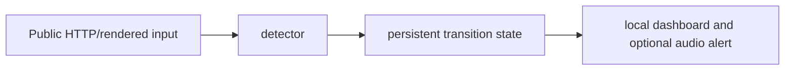

# Launch Availability Monitor

**Durable availability transitions, coverage state and local alerts.**

  [](LICENSE)

[Overview](#overview) · [Quickstart](#quickstart) · [Example](#example) · [Validation](#validation) · [Documentation](#documentation)

## Overview

A local dashboard that tracks public launch availability transitions, new entries and coverage failures.

**Stack:** Python · requests · BeautifulSoup · Playwright · SQLite · HTML dashboard

## A transition is more than a changed flag

| Component | Behavior |
| --- | --- |
| Detection | Explicit enabled-state transitions identify newly available launches. |
| Durability | SQLite retains state and deduplication across detector restarts. |
| Coverage | Retries, backoff and failure state remain visible to the local interface. |

## Processing path



## Quickstart

```console
python -m venv .venv
# Activate .venv, then:
python -m pip install -r requirements.txt
python -m unittest discover -s tests -v
```

The commands above install prerequisites or run the specified offline checks. Live collection, cloud operations, messaging and trading are separate operational steps when present.

## Example

**Inspect the workflow**

Compare a previously unavailable fixture with an available fixture, then inspect whether one transition is retained. Repeat the observation to examine deduplication. Browser-based collection and optional audio belong to the operational monitor, separate from the offline fixture suite.

## Configuration and storage

HTTP and rendered-page inputs use requests/BeautifulSoup/Playwright paths. SQLite stores detector history. Browser runtime installation and live source selection are separate prerequisites.

## Repository guide

| Location | Responsibility |
| --- | --- |
| [monitor.py](monitor.py) | Monitor entrypoint |
| [twice_monitor](twice_monitor) | Detection and persistence modules |
| [dashboard.html](dashboard.html) | Local interface |
| [tests](tests) | Offline detector checks |

## Validation

These checks use offline fixtures or controlled backends.

## Scope and operational boundaries

Offline fixtures do not establish current selectors, endpoint availability or one-second detection reliability. Throttling and source changes can reduce coverage; the dashboard should be read with that coverage context.

## Documentation

- The repository guide above links directly to the implementation and configuration files.

## License and attribution

Project-authored source code is licensed under the [MIT License](LICENSE). Third-party components and datasets retain their respective rights and licenses.
