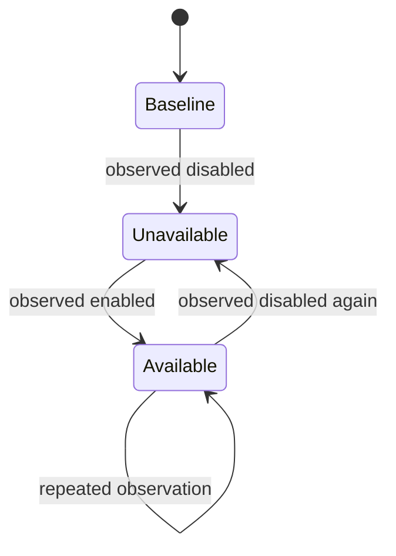

# Launch Availability Monitor

  [](LICENSE)

Track Twice launch availability as persistent transitions, rather than repeatedly alerting on an unchanged page.

The monitor combines HTTP/rendered-page observations, a local dashboard and SQLite history. It records deployment availability, discovered addresses and alert-channel state, so restarting the process does not automatically make every old observation new again.

## What survives a restart

[core.py](twice_monitor/core.py) maintains SQLite tables for state, seen identities and events. Event acknowledgement, sound delivery and chat delivery have separate timestamps. The detector initializes its baseline from prior inspection material when available; the first observation is not automatically a new-launch alert.



The diagram illustrates availability tracking; source coverage/failure state is tracked alongside the observations.

## Exercise the detector offline

```console
python -m venv .venv
python -m pip install -r requirements.txt
python -m unittest discover -s tests -v
```

[tests/test_monitor.py](tests/test_monitor.py) provides the local regression surface. [monitor.py](monitor.py) is the operational entrypoint and [service.py](twice_monitor/service.py) coordinates source polling and dashboard behavior. Live rendered-page collection needs its browser runtime and current source compatibility.

The repository records historical source inspection under [research](research). Those files are context for the detector, not proof that today's selectors, endpoints or detection interval are reliable. Optional sound/chat alerts require separate local configuration.

**Technology:** Python · requests · BeautifulSoup · Playwright · SQLite · HTML dashboard

Project-authored source: [MIT](LICENSE). Third-party components retain their own notices and terms.
